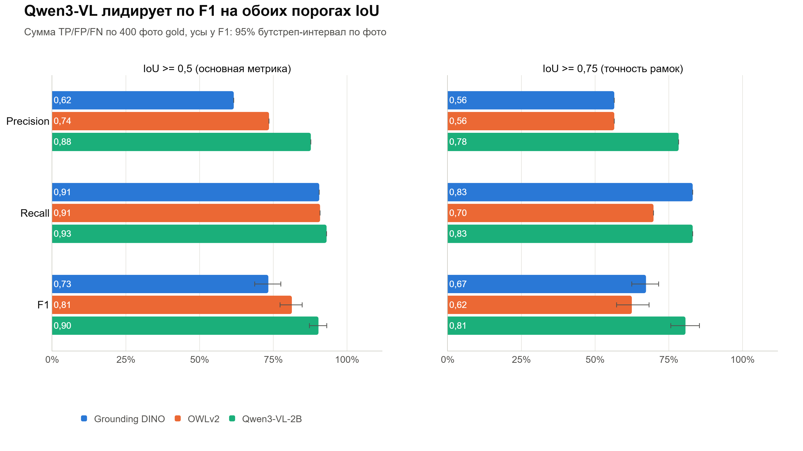

# Поиск бабочек: разметка, проверка и сравнение моделей

Командный проект курса краудсорсинга ШАД, 2026. На фотографиях выделяем всех взрослых дневных и ночных бабочек, включая моль. Другие насекомые, гусеницы, куколки и изображения бабочек на рисунках не относятся к целевому классу.

**Результат:** 400 фотографий CC0, проверка bbox отдельными исполнителями, эталон из 361 рамки, сравнение Grounding DINO tiny, OWLv2 base и Qwen3-VL-2B-Instruct. Для экзамена выбран Qwen. Капитан сообщил о результате **10/10 в Контесте** 20 ноября. Балл экзамена не является точным значением F1.

## Актуальные результаты

Метрики считаются по `gold_400_for_metrics/gold_400_v3.jsonl`. 25 ноября исправлена принадлежность к целевому классу двух кадров с ручейниками. Все 400 фото и все модельные предсказания сохранены. История и доказательства находятся в [описании gold](gold_400_for_metrics/README.md).

| Конфигурация | F1@IoU 0,5 | F1@IoU 0,75 | Фото без бабочек с ложными рамками |
|---|---:|---:|---:|
| Grounding DINO, порог 0,25 | 0,7332 | 0,6726 | 119 / 122 |
| OWLv2, порог 0,25 | 0,8129 | 0,6245 | 53 / 122 |
| Qwen3-VL-2B | **0,9032** | **0,8065** | **24 / 122** |

Полные результаты семи конфигураций, доверительные интервалы и время: [leaderboard](eval/results/leaderboard.csv). Qwen остаётся лидером и после эксперимента с порогами 0,15 / 0,25 / 0,40 у детекторов. Дополнительная плотная сетка порогов является анализом на том же наборе, а не оценкой на независимой выборке.



## Быстро воспроизвести оценку

Для оценки сохранённых предсказаний не нужны GPU, токены платформы, скачивание весов или новые платные задания. Python 3.12:

```bash
python -m venv .venv
# Linux/macOS: source .venv/bin/activate
# Windows PowerShell: .venv\Scripts\Activate.ps1
python -m pip install -r requirements-eval.txt
python scripts/validate_package.py
python scripts/rebuild_gold.py
python eval/tests/test_metrics.py
python eval/scripts/evaluate.py
```

Оценка записывает обновлённые CSV в `eval/results/`. Фотографии для графиков не нужны:

```bash
python eval/scripts/make_figures.py
```

Экспорт PNG через Kaleido требует установленный Chrome. Для композиций с фотографиями сначала скачайте изображения:

```bash
python eval/scripts/download_images.py
python eval/scripts/make_gallery.py
```

`eval/cache_images` используется только для визуализации. Для исходных изображений с проверкой SHA-256 используйте `python scripts/download_dataset.py`. [Инференс и ограничения воспроизведения](docs/reproduction.md) описаны отдельно.

## Устройство пакета

| Каталог | Содержание |
|---|---|
| `data/main.jsonl` | Актуальные 400 источников CC0, URL, категории и SHA-256 |
| `inaturalist_dataset/`, `scripts/download_inaturalist_data.py` | Исходный сбор Элины, train/exam/main и конвертация разметки |
| `gold_400_for_metrics/` | Текущий gold v3, предыдущий v2, причины изменений и происхождение |
| `crowd/` | Инструкции, настройки, исходные обезличенные ответы, review, эталоны и бюджет |
| `models/` | Код Миши, версии моделей, параметры, полные сырые результаты и повторы |
| `model_results_400/` | Компактные предсказания семи конфигураций на финальных 400 фото |
| `eval/` | Код Kmdmrg, тесты, актуальные метрики, графики и примеры ошибок |
| `contest/` | Отдельные экзаменационные входы, автоматические ответы и журналы |
| `history/` | Результаты оценки до исправления двух эталонов |
| `docs/` | Методология, план защиты, вклад команды и воспроизведение |

В корне сохранены первоначальные `instruction.html` и `interface_template.json`. Фактически использованные инструкции и интерфейсы проектов находятся в `crowd/instructions/` и `crowd/config/`.

## Как получили gold

Пилот 20 фото → bbox ещё 380 → независимый review с перекрытием 2 → разбор разногласий и геометрии → три согласованные замены сложных изображений с отдельными bbox/review → аудит двух ошибок класса. Все этапы и исходные ответы сохранены. Авторы bbox исключались из проверки своих фото, в том числе после пропуска/истечения задания.

Разметка и экзамены стоили **650,30 ₽ с комиссией 40%** из бюджета 850 ₽. Остаток 199,70 ₽. [Параметры и бюджет](crowd/README.md).

## Ограничения

Набор специально обогащён похожими насекомыми и сложными случаями, поэтому метрики характеризуют этот состав данных. У Qwen в main остались три повторные обработки оборванных ответов с изменёнными параметрами; они исключены из сравнения времени и сохранены в истории. Устройства и версии библиотек описаны в модельных метаданных. Эталон прошёл независимый аудит, но его истинная accuracy не измерена.

## Команда и защита

[Вклад шести участников](docs/contributions.md). [Сценарий 8 слайдов на 7 минут](docs/defense_outline.md). Защита запланирована на 30 ноября по переписке команды. Файл презентации будет добавлен после сборки и проверки слайдов.

Индивидуальную форму оценки вклада каждый участник заполняет самостоятельно. Повторная отправка в Контест не требуется.
